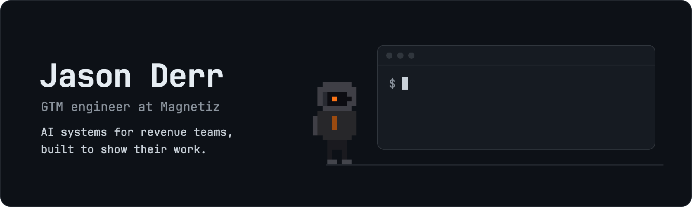

  <picture>
    <source media="(prefers-color-scheme: dark)" srcset="assets/banner-dark.gif">
    
  </picture>

## Start here

| Tool | What it does for you | |
|---|---|---|
| [video-direction-plugin](https://github.com/derrtaderr/video-direction-plugin) | A Claude Code plugin that gives AI-made brand videos a director, so they stop looking generic | Claude Code plugin |
| [monday-pipeline-brief](https://github.com/derrtaderr/monday-pipeline-brief) | Know what changed in your HubSpot pipeline before Monday's meeting, with numbers that balance | HubSpot |
| [signal-desk](https://github.com/derrtaderr/signal-desk) | A signal-to-outreach pipeline where every decision can be inspected, replayed and overruled | Outbound |
| [revenue-sync](https://github.com/derrtaderr/revenue-sync) | Stripe billing and product usage, or your warehouse, written to HubSpot and reconciled against the source | RevOps |

## Also built

- **Agents that check their own work** · [gtm-agent-evals](https://github.com/derrtaderr/gtm-agent-evals), [account-scout](https://github.com/derrtaderr/account-scout), [earn-autonomy](https://github.com/derrtaderr/earn-autonomy), [gtm-content-evals](https://github.com/derrtaderr/gtm-content-evals)
- **Signals and strategy** · [signal-drift-detector](https://github.com/derrtaderr/signal-drift-detector), [gtm-architect](https://github.com/derrtaderr/gtm-architect), [strategy-benchmark](https://github.com/derrtaderr/strategy-benchmark), [business-brain](https://github.com/derrtaderr/business-brain)
- **Shipping with agents** · [ship-check](https://github.com/derrtaderr/ship-check), [landed](https://github.com/derrtaderr/landed), [system-map](https://github.com/derrtaderr/system-map), [redaction-gate](https://github.com/derrtaderr/redaction-gate), [webhook-engine](https://github.com/derrtaderr/webhook-engine)

## Where I write

[LinkedIn](https://www.linkedin.com/in/realjasonderr/), daily · [Magnetiz playbooks](https://www.magnetiz.ai/playbooks.html) · [derr.ai](https://derr.ai)

Off the clock I surf Huntington Beach and overland off Highway 395.
